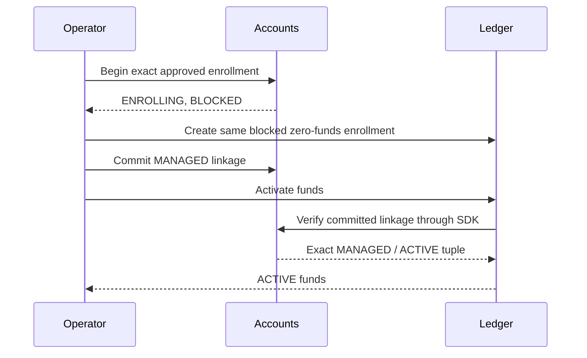

# Managed-account enrollment and lifecycle

A managed account connects canonical account identity to the ledger's explicit funds authority. Accounts owns the account, contract linkage, currency, lifecycle, and durable lifecycle-control workflow. Ledger owns booked funds, held funds, available funds, reservations, and balanced money effects.

This contract is opt-in. Existing generic account balances, spaces, and customer-position records are not authoritative opening funds for a managed account. The initial funds contract supports same-tenant, same-currency customer transfers and privileged synthetic bank-control funding. Other products, legacy migration, overdrafts, fees, FX, and external settlement require their own integrated contracts.

## Establish identity before money

A globally existing account or contract UUID is not tenant/customer ownership proof. Enrollment requires:

- A finite, issuer-verified access token for the configured accounts audience, with a subject and exact tenant.
- `funds:enroll`, `funds:tenant-bind`, and the exact account in `funds_accounts`.
- An issuer-approved exact `funds_enrollments` tuple containing tenant, account, actual canonical contract, currency, and account kind.
- `funds:bank-enroll` when the account kind is `BANK_CONTROL`.

Accounts locks and reads the actual canonical account before matching the signed tuple. It does not accept a body-supplied contract/currency claim as proof. The institution's trusted enrollment/issuer policy must establish the underlying customer/product association; the current opaque customer-position/party identifiers do not independently prove that association.

A fresh account must be open, without an overdraft, money balances, financial history, active restrictions, incompatible statements, limits, savings interest, term-deposit, or sweep records. One empty, unfrozen default `MAIN` space is allowed. No other space, balance, space transaction, or automatic transfer is accepted into zero-history enrollment.

### Enrollment sequence

Use one immutable enrollment identifier in both owners:



The ledger does not become usable merely because its blocked row exists. Activation verifies the committed accounts linkage through the generated SDK with a separate service identity. A partial enrollment remains fenced and can be retried with the same identities. Conflicting identities are explicit conflicts, not update instructions.

Beginning enrollment shares a per-account gate with alternate account and child writes. Canonical parent locking uses `FOR NO KEY UPDATE` before that gate: it protects the canonical account while allowing an already admitted child foreign-key check to finish. Child guards derive both old and new account identities, including a space's actual parent before private linkage exists, lock all gates in order, and recheck binding after waiting. This prevents an unchanged-parent `MAIN` balance write or a new space transaction from slipping past zero-history checks.

A legacy account with financial history needs a separately designed, reconciled migration. Do not manufacture a fresh account balance, delete history, or disable the fences to complete enrollment.

## Durable lifecycle controls

The supported control targets are `ACTIVE`, `BLOCKED`, and `CLOSED`. A command contains a stable `actionId` and the expected enrollment version. Reusing an action with a different account, target, or expected version conflicts. A new stale command cannot overwrite a newer lifecycle decision.

```json
{
  "actionId": "33333333-3333-4333-8333-333333333333",
  "target": "BLOCKED",
  "expectedVersion": 1
}
```

The workflow deliberately splits local transactions from network calls:

1. Recheck current tenant, scope, and account policy. Lock the account/enrollment, record an immutable command intent, and persist a pending action.
2. Commit that local intent before calling ledger through the generated `LedgerFundsApi` and a separate client-credentials identity.
3. Validate the returned account, enrollment, contract, currency, kind, and resulting ledger control state.
4. Recheck current permission and finish accounts status, enrollment version, control receipt, and status history in one local transaction.

No HTTP call is held inside the accounts database transaction. Concurrent retries of one pending action recognize a retained `COMPLETE` or `REJECTED` receipt rather than repeating status history or overwriting a different pending command.

| Target | Pending behavior | Confirmed accounts result |
| --- | --- | --- |
| `BLOCKED` | `BLOCKING` while the ledger latch is unresolved | Ledger blocked; account `SUSPENDED`; control `BLOCKED` |
| `ACTIVE` | Commit the canonical open/active linkage needed by ledger verification; retain the pending action until confirmation | Ledger active; account `OPEN`; control `ACTIVE` |
| `CLOSED` | `CLOSING`; first issue a stable distinct block action, then the original close action | Ledger closed with zero booked/held funds; account `CLOSED`; final closed control |

The enrollment verification view describes accounts authority. An `ACTIVE` field alone does not establish that ledger activation completed; observe the control command result and the ledger state for financial readiness.

A pending stage is not an acknowledged final lifecycle result. In particular, a freeze request is confirmed only after the ledger latch commits. A concurrent money commit either precedes that latch or is rejected after it. Release/expiry recovery can still remove existing holds through ledger's owning command.

### Unknown outcomes

A timeout, dropped response, unavailable peer, invalid response metadata, or unrecognized conflict leaves the pending action durable. Observe both owners and retry the same action. Do not generate a new identifier, assume that no effect occurred, or reopen a conservatively blocked account.

The block-before-close action is derived deterministically from tenant/account/original action. If a prior close response was lost and ledger is already closed, the retry can verify the retained closed result without attempting to reopen it.

### A definitive close rejection

Only the exact validated ledger response `CLOSURE_REQUIRES_BLOCKED_ZERO_FUNDS`, after the blocking phase has been confirmed, is treated as a definitive nonzero-funds rejection. Accounts then commits `BLOCKED`/`SUSPENDED`, marks the close receipt `REJECTED`, and clears the pending action before returning `ACCOUNT_CLOSURE_REJECTED_WITH_FUNDS`.

This prevents a failed close from trapping all later legitimate lifecycle work behind an unknown pending action. Resolve booked/held funds, then submit a new control using the newly observed version. Replaying the rejected action remains rejected. Other errors do not clear the pending action.

A completed close is final. Its identical retained action can replay under current permission; a new reopen command is rejected.

## API and SDK

All native paths are relative to `/api/v1/tenants/{tenant}/funds/accounts/{accountId}`.

| Method and path | Scope | Behavior |
| --- | --- | --- |
| `POST /enrollment` | `funds:enroll`, `funds:tenant-bind` | Begin exact signed zero-history enrollment; bank-control also needs `funds:bank-enroll` |
| `POST /enrollment/link` | `funds:link` | Commit the matching enrollment as managed |
| `GET /enrollment` | `funds:verify` | Read the authorized committed/current enrollment for peer verification |
| `POST /controls` | `funds:control` | Durable versioned lifecycle command |

Every operation additionally requires the current exact tenant/account grant. Retained receipt replay is not an anonymous or stale-permission bypass. A receipt collision hidden by resource policy is an explicit conflict, never an empty success.

The generated `AccountFundsApi` contains `beginFundsEnrollment`, `linkFundsEnrollment`, `verifyFundsEnrollment`, and `controlAccountFunds`. Configure its bearer identity through the SDK's supported client/authentication settings. Runtime-injected JWT/security objects are not caller parameters. Peer services must not relay a user's bearer token as their own service authority.

## Configuration

| Property | Purpose |
| --- | --- |
| `funds.security.issuer` | Trusted issuer for native managed-account requests |
| `funds.security.audience` | Accounts funds API audience |
| `funds.security.jwk-set-uri` | Resource-server verification keys |
| `funds.ledger.base-url` | Actual ledger base URL |
| `funds.ledger.token-uri` | Token endpoint for the accounts-to-ledger service identity |
| `funds.ledger.client-id` | Separate accounts lifecycle client identity |
| `funds.ledger.client-secret` | Secret supplied through the deployment secret store |
| `funds.ledger.scopes` | Issuer-approved peer scopes, including `funds:control` |
| `funds.ledger.allow-loopback-http` | Explicit local qualification option, false by default |

Peer URLs require HTTPS unless explicit loopback HTTP is enabled. Token acquisition and observations use bounded timeouts and response size. Missing trust/peer configuration fails closed. Configure the normal `DB_HOST`, `DB_PORT`, `DB_NAME`, `DB_USERNAME`, `DB_PASSWORD`, and `DB_SSL_MODE` runtime connection and separate Flyway/bootstrap credentials.

The reciprocal ledger verifier requires its own `funds.accounts.*` client configuration. Issuer policies must grant that identity `funds:verify` for the correct tenant/account resources. Issuing the right audience alone is insufficient.

## Database roles, read privacy, and compatibility

Provision the nonlogin `firefly_funds_policy_reader` and `firefly_funds_policy_writer` roles before migrations, both without superuser or RLS-bypass privileges. Use a distinct migration/bootstrap owner and a nonowner, nonsuperuser, non-bypass runtime role. Runtime must not inherit migration or policy-owner privileges and must not create public/private schema objects. Manage role authentication through the deployment secret mechanism.

The migrations assign fixed-path qualified policy/metadata functions to those helper roles with narrow privileges. Runtime managed-account operations reject privileged connections, protected-table ownership, or invalid policy-owner configuration.

Forced RLS covers account/enrollment/control receipts and linked space, balance, restriction, history, servicing, statement, limit, savings/term/sweep, parameter, provider, and notification records. Private resource linkage is inaccessible to runtime callers. Generic account/child reads cannot expose enrolled metadata merely because a financial write fence exists.

Alternate writes are fenced for both `ENROLLING` and `MANAGED`, including old/new parent identities. The narrow native control transaction may update only the allowed account status and append status history. A validated native service establishes transaction-local tenant/account/purpose on its own reactive connection; request headers cannot set this authority. Context must clear after commit, rollback, cancellation, and pool reuse.

Unmanaged legacy behavior remains available. Enrolling an account deliberately changes its compatibility: legacy balance/space/restriction/status writers and generic read projections are not automatically migrated to the new authority. Update dependent domain/experience SDK integrations before enabling the managed contract for those customers. Opaque customer-position records remain a separate downstream provenance/integration requirement and must not be displayed as authoritative managed funds.

RLS is a backstop for the qualified application role and deployment policy. It does not claim to constrain database administrators or arbitrary stolen SQL credentials.

## Run the actual two-core qualifier

The maintained qualifier starts the actual independently running accounts and ledger executable JARs, private JWT/JWKS and client-credentials fixtures, and two newly created loopback PostgreSQL containers. It creates only synthetic canonical accounts through the account API; customer funds enter only through the explicit balanced bank-control command. It does not substitute a mock ledger money service.

Prerequisites: JDK 25, Python 3.10 or later, OpenSSL, a local Docker CLI/daemon, and both freshly verified executable JARs. Use the repository Maven lifecycle to generate their SDKs from the real producer API before qualification. The qualifier does not compile, publish, install artifacts, or use the shared OpenAPI producer port.

```bash
python3 scripts/qualify-managed-funds.py \
  --accounts-jar /path/to/core-banking-accounts-web/target/core-banking-accounts-exec.jar \
  --ledger-jar /path/to/core-banking-ledger-web/target/core-banking-ledger.jar \
  --output-dir /path/to/private-qualification-output
```

The script uses `JAVA_HOME` or `--java` and the Docker CLI's local configuration, with optional `DOCKER_HOST`/`--docker-host`. It freezes private copies of both input JARs, records their SHA-256 identities, and writes a machine-readable result and runtime logs. Database roles, signing keys, account data, and credentials are disposable synthetic fixtures. Cleanup stops only the container identifiers created by that invocation and its own child processes.

The qualification exercises actual activation/linkage, generated SDK calls in both directions, balanced funding, holds, commit/replay, restarts and lost-response recovery, opposite transfers, lifecycle latch/commit races, definitive closure rejection, closed replay, expiry, no-effect reconciliation, and exact final conservation. Its success is bounded to this internal funds/lifecycle contract. It does not qualify payment domain/experience orchestration, external rails, provider production configuration, or the institution's business authority policy.

For reservation state, absolute deadlines, authoritative no-effect receipts, bank-control funding, and ledger operations, see the [ledger managed-funds guide](https://github.com/fireflysoftwaresolutions/core-banking-ledger/blob/main/docs/managed-funds.md).
